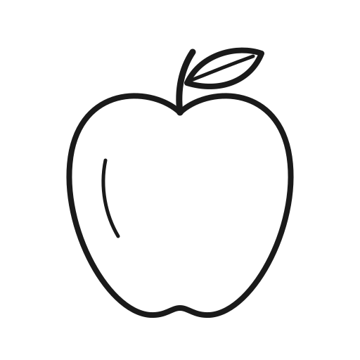

# FLN SVG Library

A library of print-quality SVG illustrations for **FLN (Foundational Literacy & Numeracy)** worksheets for
**LKG, UKG, Class 1, Class 2 and Class 3**.

The illustrations are made to fill the image placeholders in our worksheet templates. Each one shows a single
everyday object that a young child can name at a glance: an apple, a cow, a pencil, a ball.

## Folder structure

```
svg-library/
  animals/              cow, dog, cat, elephant, lion, ...
  birds/                parrot, peacock, crow, sparrow, ...
  fruits/               apple, banana, mango, grapes, ...
  vegetables/           carrot, tomato, brinjal, potato, ...
  flowers-plants/       rose, sunflower, lotus, tree, ...
  stationery/           pencil, eraser, sharpener, crayon, ...
  school/               school-bag, book, blackboard, desk, ...
  clothing/             t-shirt, frock, shorts, cap, shoes, ...
  sports/               ball, cricket-bat, football, kite, ...
  nature-environment/   sun, hills, river, cloud, rainbow, ...
  transport/            bus, bicycle, car, train, boat, ...
  household/            cup, chair, clock, umbrella, lamp, ...
  food/                 roti, rice-bowl, milk-glass, ...
  body-parts/           hand, eye, ear, nose, ...
  shapes-colors/        circle, square, triangle, star, ...
  numbers-counting/     counters, beads, dots, ...
```

## Naming

- Lowercase kebab-case, named after the object: `apple.svg`, `cricket-bat.svg`, `school-bag.svg`
- Variants get a suffix: `apple-green.svg`, `cow-sitting.svg`, `pencil-outline.svg`

## Using an SVG in a worksheet

Every file uses a square `viewBox="0 0 512 512"` and has no fixed width or height, so it scales to any
placeholder:

```html

```

See [STYLE_GUIDE.md](STYLE_GUIDE.md) for the rules every illustration follows.

## Workflow

1. New illustrations are drafted outside the repo.
2. Each draft is rendered and reviewed by a person.
3. Only approved SVGs are moved into `svg-library/<category>/` and committed.

